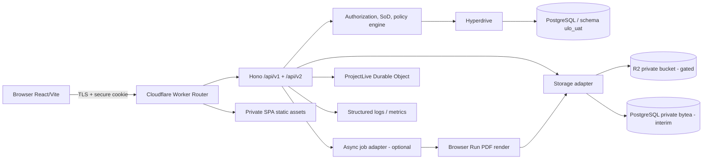

# Technical Specification — QA Manager 2.0

[Indeks dokumentasi](../../README.md) · [Domain Arsitektur](../README.md)
**Versi:** 2.0.0-draft | **Tanggal:** 21 November 2026 | **Status:** PROPOSED / design-to-implement  
**Referensi:** [PRD QA Manager v2](../../product/prd/PRD-QA-Manager-v2.md) | Repo: saibapna/qamanager @ 82b7e5b2cbf9f4725a4ccc37568c067ec716bd86  
**Implementasi saat ini:** React 18 + Vite + TypeScript, Hono 4.x pada Cloudflare Worker, PostgreSQL/Supabase via Hyperdrive, Browser Run untuk PDF. Express di root adalah backend legacy/lokal. Detail teknis version-pinned harus diverifikasi dari package-lock dan hasil build pada setiap PR.

> **Status pembuktian.** **Observed** = berkas/kode terlihat saat review, **Target** = kontrak desain, **Blocked** = tidak dapat dinyatakan siap tanpa bukti/provider/mandat. Dokumen ini bukan bukti telah dideploy. Jangan menerapkan contoh SQL secara langsung ke production tanpa migration review, backup, dan perbandingan skema aktual.

## 1. Architecture Decision Records (ADR) ringkas

| ADR | Keputusan TARGET | Alasan | Keterbatasan / syarat |
|---|---|---|---|
| ADR-001 | Pertahankan React/Vite + Hono/Workers, modular monolith | Migrasi bertahap, kompatibel deployment | Hindari rewrite full-stack sekaligus |
| ADR-002 | PostgreSQL privat sebagai system of record; schema aplikasi terisolasi | Relasional, transaksi, audit, reporting | Hyperdrive digunakan hanya dari server Worker |
| ADR-003 | R2 sebagai storage objek **bila tersedia**; adapter bytea sebagai interim | Pisahkan blob dan metadata, biaya/skalabilitas | R2 akun belum dibuktikan siap; jangan migrasi sebelum tes dan izin |
| ADR-004 | Domain QA, QC, UAT dan Release dipisah secara logis | Mencegah penyamaan process finding dengan defect | API legacy UAT tetap kompatibel |
| ADR-005 | Mandatory scoped authorization dan SoD pada layanan | Sistem administratif pemerintah | Role string tidak otomatis memberi kewenangan hukum |
| ADR-006 | Domain events append-only dan snapshot immutability; mutasi+audit atomik | Chain of custody | DB trigger bukan WORM penuh; butuh backup/access controls |
| ADR-007 | Gate policy berversi, evaluasi deterministik di backend | Keputusan dapat diaudit dan direproduksi | Tidak boleh dijalankan hanya oleh front-end |
| ADR-008 | API v2 additive, v1 ULO/UAT tetap berjalan selama masa transisi | Tanpa destructive migration | Kontrak kompatibilitas eksplisit |
| ADR-009 | Async untuk proses PDF besar/notifikasi; synchronous untuk mutasi inti | Mencegah timeout, retry aman | Cloudflare Queues/Workflows opsional dan perlu enablement |
| ADR-010 | Audit event memiliki hash, korlasi, snapshot version, actor | Traceability | Hash chain + pemeriksaan offsite sebelum klaim anti-tamper kuat |
| ADR-011 | Hanya private object access; evidence tidak punya public bucket URL | Data pemerintah dan PII | Lokasi data harus disetujui instansi |
| ADR-012 | **Approval internal ≠ tanda tangan elektronik tersertifikasi ≠ BAST** | Hindari kekeliruan hukum | PSrE/PPK memerlukan otorisasi resmi |

## 2. Topologi target



**Existing observed:** Worker entrypoint `admin-ui/worker/index.ts` menyajikan React SPA dan merutekan `/api/*` ke Hono; fallback deep link harus selalu `text/html`, tidak boleh memaksa download. `admin-ui/functions/api/[[path]].js` menangani koneksi Hyperdrive, auth/cookie, dan modul workflow. Existing domain `ulo_uat` sudah memuat projects, templates, aplikasi, sessions, test plan, defects, retests, evidence, approvals, audit events. `PROJECT_LIVE` Durable Object terlihat dalam kode; implementasi event realtime harus diuji setelah commit transaksi.

**Tidak diwajibkan:** microservices, Kafka, Kubernetes, D1, server baru, atau rewrite Express. Express tetap legacy untuk dev/compatibility, tidak menerima domain baru sebagai source of truth.

### 2.1 Batas layanan
- **API Edge:** routing, auth, tenancy, CSRF, rate limiting, validasi DTO.
- **Application Services:** requirements, QA reviews, QC runs, UAT, defect, risk, gate, approvals, releases.
- **Domain Policies:** pure functions; validasi transisi; rule versions; SoD; authorization scope.
- **Repositories:** PostgreSQL SQL terparameterisasi; transaksi terkontrol.
- **Adapters:** object storage, PDF render, realtime, email/webhooks, identity, PSrE.
- **Observability:** metrics, redacted structured events, alerts, audit export.

Struktur direktori target:
```text
admin-ui/
  src/
    app/           # router, query client, error boundary
    features/      # projects, requirements, qa, qc, uat, releases, audits
    components/    # design system, tables, form, attachments
    api/           # typed client, error contracts
  functions/api/
    index.ts       # Hono composition/bootstrap; legacy handler delegated
    middleware/    # auth, tenant-context, csrf, validation, tracing
    modules/
      identity/    project/     requirement/
      qa/          risk/        qc/
      defect/      gate/        approval/
      release/     uat/         report/
    policies/
    repositories/
    adapters/
  worker/
    index.ts       # SPA + API routing, preserve deep-link fix
db/
  migrations/      # ordered forward-only SQL
  verification/    # post-migration assertions
api-docs/
  openapi-v2.yaml
docs/product/prd/
docs/architecture/specifications/
```
Folder target tidak perlu dibuat sekaligus; pindahkan modul dengan karakterisasi tes dan route parity.

## 3. Multi-tenancy dan identitas organisasi

### 3.1 Model tenancy
Satu tenant = satu boundary kontraktual dan akses data; tidak otomatis sama dengan satu OPD. `tenant_id UUID` baru berelasi dengan `org_units`, `projects`, `users` melalui `tenant_memberships`. Pengguna dapat menjadi anggota beberapa tenant, tetapi seluruh query scoped ke **tenant aktif yang diverifikasi di server**.

Kebijakan:
1. `tenant_id` bukan input yang dipercaya dari body; ambil dari resource dan membership.
2. Semua route menolak missing/invalid membership, termasuk download, bulk export, PDF, event-stream, dan soft-delete.
3. Semua relasi project/resource memakai composite FK atau guarded transaction untuk mencegah relasi lintas tenant.
4. Jangan mengandalkan `WHERE project_id = :id` tanpa membership check.
5. Referensi 64-bit di API JSON berupa **string** jika melebihi `Number.MAX_SAFE_INTEGER`; UUID direkomendasikan untuk entitas baru.
6. Admin platform tidak otomatis mengakses evidence tenant; support access harus time-bound, explicit approval, audit.
7. Setiap pergantian tenant menutup cache, subscription dan stale query data pada UI.

### 3.2 Gap security existing (harus ditangani sebelum produksi multi-tenant)
Migration existing memberi policy `qamanager_backend_access USING(true)` untuk role SQL `qamanager_web`, sehingga **RLS tersebut bukan per-tenant policy**. RBAC API saat ini memeriksa `project_members`, tetapi migrasi enterprise memerlukan defense-in-depth:
- Kunci semua endpoint dan JOIN dengan scope project/tenant.
- Beri DB role `qamanager_web` privilege minimum, bukan table owner/BYPASSRLS.
- Untuk RLS per-tenant, gunakan `SET LOCAL app.tenant_id` **di dalam transaksi dengan dedicated client** dan policy `tenant_id = nullif(current_setting('app.tenant_id', true),'')::uuid` untuk tabel v2. Pastikan `SET LOCAL` tidak bocor antar request/pool; jangan menerapkan RLS v2 pada tabel legacy sebelum kompatibilitas teruji.
- Backfill `tenant_id` per project berdasar mapping resmi; tidak boleh menebak tenant pemilik data.
- Uji SQL injection, lateral joins, subqueries, output PDF, storage metadata, dan filter ekspor.

### 3.3 RBAC + ABAC
Role baseline legacy `ADMIN,TESTER,WITNESS,APPROVER,AUDITOR` tetap didukung, lalu tambahkan granular **permissions** dan **assignments** ber-scope; `platform_admin` terpisah. Action DSL: `qa.control.review`, `qa.finding.verify`, `qc.run.execute`, `defect.resolve`, `risk.accept`, `uat.witness.approve`, `uat.owner.accept`, `release.approve`, `evidence.read`, `audit.export`.

| Operasi | QA Lead | QC Lead/Tester | Developer | Business Owner | Security | Auditor |
|---|---|---|---|---|---|---|
| Definisikan QA control/plan | C/U | R | - | C | C | R |
| Verifikasi QA finding | A / SoD | - | - | R | C | R |
| Test execution | R | C/U | - | R untuk UAT | R | R |
| Perbaiki defect | R | R | C/U | R | R | R |
| Verify retest | R | C/U / SoD | - | R | C | R |
| Setujui UAT | R | - | - | A | C | R |
| Risk acceptance | Review | Review | - | A sesuai mandat | Review | R |
| Approve release | Recommend | Recommend | - | A sesuai mandat | Recommend | R |
| Edit audit event | - | - | - | - | - | - |

Legenda: C/U create/update; R read; A approval. Ini **contoh kebijakan**, bukan pemberian otomatis hak akses pejabat. Enforcement selalu pada API + DB, dengan status kebijakan dan scope revisi.

## 4. Model data target

### 4.1 Existing entities yang dipertahankan
`ulo_uat.projects`, `aplikasi`, `templates`, `test_plan_items`, `ulo_sesi`, `ulo_item`, `ulo_defects`, `ulo_retests`, `ulo_evidence`, `ulo_approvals`, `ulo_output`, `template_fixtures`, `project_members`, `users`, `audit_events`. Integritas dan status historis harus dipertahankan saat upgrade. Jangan menghapus data sesi FINAL/SIGNED lama atau mengubah PASS/FAIL-nya.

### 4.2 New entities: minimum viable schema outline

| Table (schema `ulo_uat` atau schema domain privat) | Field penting | Constraints / index |
|---|---|---|
| tenants | id UUID, code, name, state, data_region_policy | UNIQUE(code) |
| org_units | id, tenant_id, parent_id, code, name | UNIQUE(tenant_id,code), parent tenant check |
| tenant_memberships | tenant_id, user_id, status | UNIQUE(tenant_id,user_id) |
| role_assignments | id, tenant_id, project_id?, subject_id, permission_role, scope_type/id, expires_at, mandate_ref | partial uniqueness untuk yang aktif |
| projects_v2_meta | project_id (FK legacy), tenant_id, product_owner, risk_profile, lifecycle_template_id | UNIQUE(project_id,tenant_id) |
| requirements | id, tenant_id, project_id, stable_key, title, body, priority, owner_id, current_revision | UNIQUE(project_id,stable_key), composite FK |
| requirement_revisions | requirement_id, revision_no, acceptance_criteria JSONB, checksum, status, actor_id | UNIQUE(requirement_id,revision_no), immutable BASELINED |
| change_requests | id, project_id, target_object, base_revision, diff, impact, status, approver_id | idempotency + revision CAS |
| requirement_links | requirement_rev_id, test_case_version_id, link_type | PK(pair) |
| qa_plans | id, project_id, version, status, standards_snapshot | UNIQUE(project_id,version) |
| qa_controls | id, tenant_id, code, version, phase, policy_json, effective_from | UNIQUE(tenant_id,code,version) |
| qa_reviews | id, project_id, control_id, stage, assessment, evidence_snapshot, reviewed_by | indexed by stage/status |
| qa_findings | id, review_id, severity, status, owner_id, due_at, explanation | indexed by project/status/due |
| corrective_actions | id, finding_id, type CAPA, owner_id, due_at, completed_at, verified_by, verification_result | immutable action events |
| risk_register | id, project_id, category, likelihood, impact, residual_level, owner_id, treatment, acceptance_id | indexed by project/residual |
| test_plans | id, project_id, kind, version, published_at, checksum | UNIQUE(project_id,kind,version) |
| test_case_versions | id, test_plan_id, case_key, rev, steps JSONB, expected_result, applicable | UNIQUE(test_plan_id,case_key,rev) |
| test_runs | id, plan_id, plan_hash, release_id?, status, revision, created_by | immutable plan snapshot |
| test_results | id, run_id, case_version_id, attempt_no, status, note, actor_id, recorded_at | UNIQUE(run_id,case_version_id,attempt_no) |
| defects_v2_meta | legacy_defect_id?, tenant_id, project_id, priority, detection_run_id, due_at, risk_id? | FK and scope integrity |
| defect_events | id, defect_id, old/new_state, note, actor_id, happened_at | append-only |
| artifact_objects | id, tenant_id, project_id, key, storage_backend, sha256, media_type, size, classification, status | unique random key, no public URL |
| artifact_links | artifact_id, object_type/id, immutable_ref_version | index project/owner |
| gate_policies | id, tenant_id, gate_code, version, effective_at, rules_json, hard_blockers | UNIQUE(tenant_id,gate_code,version) |
| gate_evaluations | id, project_id, release_id?, gate_policy_id, evaluated_revision, result, snapshot_hash, actor_id | immutable result history |
| waiver_decisions | id, defect_id/risk_id, justification, expires_at, authorized_actor, scope | cannot silently waive blocker |
| release_records | id, project_id, version, commit_sha, artifact_hash, environment, state, deployment_ref | UNIQUE(project_id,version,environment) |
| approval_decisions | id, workflow_kind, object_id, object_revision, payload_hash, role, actor_id, decision | UNIQUE(object,revision,role,actor) / SoD |
| artifact_retention | artifact_id, policy_id, retain_until, hold_until, purge_state | lifecycle guard |
| idempotency_keys | scope_id, key_hash, route, request_hash, response_ref, expires_at | UNIQUE(scope_id,key_hash) |

**Modeling rule:** Field `tenant_id` di semua tabel v2 berisi immutable ownership, `project_id` selalu punya tenant yang sama, foreign key tidak `ON DELETE CASCADE` untuk data audit/resmi. Reference baru **UUID** dapat digunakan tanpa mengubah legacy bigint. `status` dilengkapi CHECK atau enum migration-controlled; timestamps UTC di DB; display timezone Asia/Jakarta berdasarkan locale pengguna.

### 4.3 Skeleton DDL (ilustratif, bukan migrasi siap-jalankan)

```sql
CREATE TABLE ulo_uat.tenants (
  id uuid PRIMARY KEY,
  code text NOT NULL UNIQUE,
  name text NOT NULL,
  status text NOT NULL CHECK(status IN ('ACTIVE','SUSPENDED','ARCHIVED')),
  created_at timestamptz NOT NULL DEFAULT now()
);
CREATE TABLE ulo_uat.projects_v2_meta (
  project_id bigint PRIMARY KEY REFERENCES ulo_uat.projects(id) ON DELETE RESTRICT,
  tenant_id uuid NOT NULL REFERENCES ulo_uat.tenants(id),
  lifecycle_profile text NOT NULL DEFAULT 'GOV_SDLC_V1',
  policy_version integer NOT NULL DEFAULT 1 CHECK(policy_version > 0),
  created_at timestamptz NOT NULL DEFAULT now(),
  UNIQUE(project_id,tenant_id)
);
CREATE INDEX idx_projects_v2_tenant ON ulo_uat.projects_v2_meta(tenant_id,project_id);

CREATE TABLE ulo_uat.gate_policies (
  id uuid PRIMARY KEY,
  tenant_id uuid NOT NULL REFERENCES ulo_uat.tenants(id),
  gate_code text NOT NULL,
  version integer NOT NULL CHECK(version > 0),
  rules_json jsonb NOT NULL,
  hard_blockers jsonb NOT NULL DEFAULT '[]'::jsonb,
  published_at timestamptz,
  checksum char(64) NOT NULL,
  UNIQUE(tenant_id,gate_code,version)
);
CREATE TABLE ulo_uat.gate_evaluations (
  id uuid PRIMARY KEY,
  project_id bigint NOT NULL REFERENCES ulo_uat.projects(id),
  gate_policy_id uuid NOT NULL REFERENCES ulo_uat.gate_policies(id),
  release_ref uuid,
  source_revision bigint NOT NULL CHECK(source_revision > 0),
  snapshot_hash char(64) NOT NULL,
  result text NOT NULL CHECK (result IN
    ('PASS','PASS_WITH_ACCEPTED_RISK','FAIL','NOT_EVALUATED')),
  evaluated_by bigint NOT NULL REFERENCES ulo_uat.users(id),
  evaluated_at timestamptz NOT NULL DEFAULT now(),
  reasons jsonb NOT NULL DEFAULT '[]'::jsonb
);
CREATE INDEX idx_gate_eval_project_at
  ON ulo_uat.gate_evaluations(project_id,evaluated_at DESC);
```

Sebelum produksi: tambah ownership/composite FK, RLS, grants, audit triggers, migration tracking dan index berdasarkan query plan. SQL di atas tidak menerapkan semuanya.

### 4.4 Integritas transaksi dan event
Untuk mutasi business-critical:
1. Mulai transaksi pada dedicated PostgreSQL client.
2. Ambil lock baris project/entity; validasi tenant membership + permission + current revision.
3. Mutasi domain dengan `WHERE id=$1 AND revision=$2` / `SELECT ... FOR UPDATE`.
4. Tulis `audit_events` dan `outbox_events` **dalam transaksi yang sama**, bukan setelah commit.
5. Commit; baru publish realtime/queue via outbox dispatcher. Retries tetap idempotent.
6. Pada conflict versi, balas `409 REVISION_CONFLICT`; UI wajib refresh snapshot.

Setiap audit event: `event_id`, `tenant_id`, `project_id`, `actor_id`, `action`, `entity_id`, `entity_revision`, `occurred_at`, `correlation_id`, `request_id`, `source_ip_hash` (bukan IP mentah bila tak perlu), `before_hash`, `after_hash`, `change_summary_redacted`. Audit append-only; chain digest periodik diekspor ke boundary independen setelah disetujui untuk deteksi manipulasi yang lebih kuat.

## 5. API Design Contract

### 5.1 Versi dan standar
- **Existing:** `/api/*` Hono saat ini tetap dipertahankan sebagai compatibility façade (lihat `api-docs/openapi.yaml`).
- **Target:** `/api/v2/*` berkontrak OpenAPI 3.1; DTO zod/types dihasilkan dan teruji.
- JSON UTF-8, timestamp ISO-8601 UTC, ID string untuk UUID dan bigint; default `limit=25`, maximum `limit=100`; cursor pagination stabil (`id,created_at`), filter whitelist.
- Required mutation headers: `X-Requested-With: XMLHttpRequest` untuk cookie-authenticated requests di compatibility mode, `X-Request-ID`, `Idempotency-Key` untuk create/finalize/approval; CSRF guard sesuai mekanisme teruji.
- Auth cookie HttpOnly + Secure + SameSite; server-side permission; never trust `tenantId` dari payload.
- Successful create: 201 + resource ID; async create: 202 + job ID; update: 200/204; conflicts 409; validation 422; unauth 401; forbidden 403 atau 404 (resource masking); 429 throttle; 500 tanpa stack/secrets.

Error JSON standar:
```json
{
  "error": {
    "code": "GATE_BLOCKED",
    "message": "Kriteria wajib quality gate belum terpenuhi",
    "details": [{"rule": "CRITICAL_DEFECT_OPEN", "entityId": "def_123"}],
    "requestId": "opaque-correlation-id"
  }
}
```

### 5.2 Endpoint target (semuanya TARGET baru kecuali route v1 dicatat existing)

| Domain | Method & path (v2, prefix `/api/v2`) | Permission / semantics |
|---|---|---|
| Identity | GET /me; GET /tenants; POST /tenants/:id/switch | Membership-bound; switch mengembalikan scoped context |
| Org | GET/POST /tenants/:id/org-units; PATCH /org-units/:id | tenant.manage |
| Projects | GET/POST /projects; GET/PATCH /projects/:id | project.read / project.manage |
| Members | GET/POST /projects/:id/assignments; DELETE /assignments/:id | permissions.manage; last-admin guard |
| SDLC | GET/POST /projects/:id/lifecycle; GET /projects/:id/milestones | sdlc.manage/read |
| Requirements | GET/POST /projects/:id/requirements; GET /requirements/:id | req.read/create |
| Req revision | POST /requirements/:id/revisions; POST /requirements/:id/baseline | req.edit/approve; revision CAS |
| Change requests | POST /requirements/:id/changes; POST /changes/:id/decisions | req.request_change/approve |
| Traceability | GET /projects/:id/traceability; POST /requirements/:id/test-links | req.read/test.plan.link |
| QA Plans | GET/POST /projects/:id/qa-plans; POST /qa-plans/:id/publish | qa.plan.manage |
| QA Controls | GET/POST /tenants/:id/qa-controls; POST /qa-controls/:id/publish | qa.policy.manage |
| QA Reviews | POST /projects/:id/qa-reviews; PATCH /qa-reviews/:id | qa.review.perform |
| Findings/CAPA | GET/POST /projects/:id/qa-findings; POST /qa-findings/:id/actions; POST /actions/:id/verify | qa.finding.* + SoD |
| Risks | GET/POST /projects/:id/risks; POST /risks/:id/acceptances | risk.manage/accept |
| QC Plans | GET/POST /projects/:id/test-plans; POST /test-plans/:id/publish | qc.plan.manage |
| QC Cases | GET/POST /test-plans/:id/cases; POST /cases/:id/revisions | qc.case.manage |
| QC Runs | POST /test-plans/:id/runs; GET /runs/:id; POST /runs/:id/results | qc.run.execute; idempotent attempt |
| Defects | GET/POST /projects/:id/defects; PATCH /defects/:id | defect.read/edit |
| Retests | POST /defects/:id/retests; GET /defects/:id/events | qc.retest.verify |
| Evidence | POST /artifacts/upload-intents; POST /artifacts/:id/finalize; GET /artifacts/:id/download | evidence.write/read; upload adapter |
| Gates | GET /projects/:id/gates; POST /projects/:id/gates/:code/evaluate | qa.gate.evaluate |
| Gate policies | GET/POST /tenants/:id/gate-policies; POST /gate-policies/:id/publish | policy.manage |
| Waivers | POST /defects/:id/waivers; GET /waivers/:id | risk.accept + SoD |
| Releases | GET/POST /projects/:id/releases; POST /releases/:id/submit | release.manage/submit |
| Approvals | GET /approvals/pending; POST /releases/:id/decisions | release.approve; mandate + SoD |
| Deployments | POST /releases/:id/deployments; POST /deployments/:id/verification | release.deploy/verify |
| UAT bridge | GET /projects/:id/uat/sessions; GET /uat/sessions/:id | existing data via normalized projection |
| Reports | POST /projects/:id/reports; GET /report-jobs/:id; GET /reports/:id/download | report.generate/read |
| Audit | GET /projects/:id/audit-events; POST /projects/:id/audit-exports | audit.read/export |
| Dashboard | GET /projects/:id/qa-metrics; GET /projects/:id/qc-metrics | scoped read with metric metadata |

**Contoh create defect:** `POST /api/v2/projects/{projectId}/defects` membawa `testResultId`, `title`, `severity`, `priority`, `ownerId` opsional. Service memeriksa hasil FAIL, tenant, uniqueness per failure event/idempotency key, lalu membuat defect + audit/outbox atomik. **Tidak** membiarkan `ownerId` dari project lain.

### 5.3 API acceptance
Semua endpoint wajib contract tests dari OpenAPI; schema request/response, role-matrix, negative tenancy, idempotency duplicate/replay, CSRF, oversized upload, missing evidence, dan version conflict. GET/export harus diuji terhadap data project yang bukan membership caller.

## 6. State machines dan policy engine

### 6.1 Distinct states
- QA finding: `OPEN → ACTION_PLANNED → IMPLEMENTED → VERIFIED / REOPENED`.
- QC result: `NOT_RUN / PASS / FAIL / BLOCKED / NOT_APPLICABLE` per *attempt*; bukan status defect.
- Defect: `OPEN → IN_PROGRESS → FIXED → VERIFIED / REOPENED`; `WAIVED` pengecualian terdokumentasi.
- UAT legacy: `BELUM/PASS/FAIL`, `DRAFT/FINAL/SIGNED`; bridge mapper menjaga snapshot historis.
- Release: `DRAFT → CANDIDATE → REVIEWED → APPROVED → DEPLOYED → VERIFIED / ROLLED_BACK`.
- Gate: `NOT_EVALUATED`, `FAIL`, `PASS_WITH_ACCEPTED_RISK`, `PASS`.

Policy tidak boleh mengevaluasi status `SIGNED` sebagai bukti PSrE tersertifikasi. Mutasi pasca-approval menghasilkan revision baru dan menginvalidasi approval versi sebelumnya untuk operasi selanjutnya.

### 6.2 Gate policy JSON (versi contoh)
```json
{
  "policyCode": "G6_RELEASE",
  "version": 1,
  "scope": "project-release",
  "rules": [
    {"id": "REQUIREMENTS_BASELINED", "source": "requirements", "op": "allBaselined", "block": true},
    {"id": "QA_CRITICAL_FINDINGS", "source": "qa", "op": "openAtLeast", "severity": "CRITICAL", "max": 0, "block": true},
    {"id": "QC_COVERAGE", "source": "qc", "op": "coverageAtLeast", "threshold": 0.95, "block": false},
    {"id": "CRITICAL_DEFECT_OPEN", "source": "qc", "op": "openAtLeast", "severity": "CRITICAL", "max": 0, "block": true},
    {"id": "UAT_ACCEPTANCE", "source": "uat", "op": "hasAuthorizedApproval", "block": true},
    {"id": "RESTORE_PLAN", "source": "release", "op": "hasRollbackPlan", "block": true}
  ]
}
```
Semua operator adalah whitelist pure functions, **bukan** eval JavaScript, SQL templating, atau kode dari UI. Evaluasi memeriksa snapshot ber-`revision` tetap, `policy checksum`, `evidence hash`, lalu menyimpan `gate_evaluations` meskipun FAIL. Penentuan threshold tergantung profil risiko instansi, angka 0.95 hanya contoh, tidak jadi default wajib tanpa keputusan.

### 6.3 Integrity gate UAT legacy
Pertahankan `assertCanonicalItems`, `checkFinalization`, `checkApprovalState` pada `workflow-core.js` sebagai kontrak karakterisasi. Existing logic mewajibkan semua item definitif dan defect VERIFIED atau WAIVED; `WAIVED` tetap `FAIL`; ketentuan X1–X5 hanya aktif per project. Tidak boleh shortcut dengan API bulk item update untuk mengubah FAIL menjadi PASS.

## 7. Evidence, PDF, storage, dan chain of custody

### 7.1 Penyimpanan objek
Implementasikan interface `ObjectStore`: `put({tenantId,classification,bytes,sha256})`, `getAuthorized(objectId,principal)`, `markDeleted(objectId,reason)`, `verifyHash(objectId)`, `lifecycle(objectId)`, `health()`.

**Existing interim:** private PostgreSQL `bytea` pada `ulo_evidence` dan PDF/fixture dengan batas ukuran/kuota; file soft-delete tetap memakai kuota. **Target production:** private Cloudflare R2 setelah binding, akses, lokasi data, lifecycle, backup, dan restore diuji. Metadata searchable tetap di PostgreSQL. Jangan menampilkan R2 public URL atau credential.

Object key generated server-side: `tenants/<tenant-uuid>/projects/<project-id>/<type>/<random-uuid>/<sha256>`; jangan gunakan filename user sebagai path. Atur status `PENDING_UPLOAD → QUARANTINED → AVAILABLE / REJECTED / DELETED / PURGED`; izinkan hanya PDF/PNG/JPEG pada UAT legacy; ekstensi tambahan melalui allowlist; validasi magic bytes dan antivirus/scanning bila tersedia. Untuk storage adapter masa transisi, gunakan strict quota per tenant/project/object dan transfer berizin melalui backend.

**Upload flow:**
1. Mint `upload_intent` setelah permission, ownership, content type, quota dan classification check.
2. Upload privat; uji content hash, real MIME dan ukuran aktual; reject mismatch.
3. Scan sesuai kapasitas; karantina sampai lengkap. Jangan render HTML/SVG aktif dalam browser.
4. Transaksi metadata `AVAILABLE` + audit/outbox; tangani orphan object lewat reconciler.
5. Download via Worker dengan AuthZ fresh setiap permintaan; headers `Content-Disposition: attachment`, `Cache-Control: private,no-store`, `X-Content-Type-Options: nosniff`.
6. Hapus = tombstone, tidak benar-benar purge selama legal hold/retensi. Purge memerlukan job, approval, audit dan bukti hasil.

**Regulasi dan lokasi:** jangan berasumsi penyimpanan R2 di region tertentu otomatis memenuhi seluruh kewajiban data pemerintah. Ada proses klasifikasi data, penilaian cloud/supplier, kontrak, enkripsi, kunci, data residency, dan keputusan unit berwenang.

### 7.2 PDF report
Engine legacy Cloudflare Browser Run untuk rendering; setiap laporan memakai **snapshot immutable** dari input, template revision, style assets, actor/approval. Cegah render-to-output race:
- Catat `source_revision`, `template_checksum`, `policy_checksum` sebelum render.
- Render PDF, hitung SHA-256, jumlah halaman, waktu.
- Transaksi penyimpanan output memverifikasi `source_revision` saat commit; bila berubah, discard hasil stale.
- Simpan versi hasil dan metadata; jangan replace output final.
- Browser Run tidak mendapat cookie pengguna; gunakan internal signed render token scoped, TTL singkat, satu kali jika memungkinkan.

**Pembandingan 1:1:** official baseline (diunggah pemilik dokumen, izin penggunaan, hash/versi) dibandingkan berdasarkan teks, dimensi/layout, jumlah halaman **fisik**, raster DPI sama, deterministic fonts, SSIM per halaman, pixel diff mask/heatmap. SHA-256 **bukan** bukti sama visual. Angka PRD lama SSIM >= 0.999 dan halaman 5 merupakan **acceptance khusus template tersebut**, bergantung pada fixture resmi. Synthetic fixtures hanya membuktikan comparator bekerja.

**Performa:** uji benchmark 71 kasus dengan ukuran representatif; p95 target awal <30 detik via async queue (bukan blocking HTTP panjang), angka 5 detik lama adalah target aspiratif yang belum terbukti. Jobs state `QUEUED/RUNNING/COMPLETE/FAILED/RETRYING`, retries idempotent dan dead-letter runbook.

### 7.3 Signatures / decisions
Simpan keputusan in-app `actor_id`, `role_assignment_id`, `decision`, `timestamp`, `document_sha256`, `source_revision`, `challenge_method` untuk audit internal. Bila diperlukan **tanda tangan elektronik tersertifikasi**, gunakan adapter PSrE berwenang dengan validasi sertifikat, signature payload, hash, timestamp, dan revocation/status; jangan menampilkan "tersertifikasi" sebelum verifikasi. BAST adalah dokumen dan keputusan administratif dalam alur terpisah; sistem boleh mengarsipkannya, bukan menerbitkan kewenangan PPK.

## 8. Auth, privacy, dan security specification

**Existing observed:** cookie `qa_access` / `qa_refresh` HttpOnly Secure SameSite=Strict, JWT 15 menit / refresh 7 hari, refresh revocation, per-IP/per-akun throttle, PBKDF2-SHA256 100.000 pada Workers, minimum password baru 16 karakter. Legacy Argon2 hanya kompatibilitas sisi Express. JWT secrets berbeda per jenis dan disimpan server-side.

**Target hardening:**
- Authenticate identity + project membership + specific permission + object scope pada **setiap** endpoint dan download.
- Gunakan admin invitation/SSO secara bertahap; jangan mengirim plaintext password pada `POST members` untuk produksi tanpa kanal enrollment yang aman. Tidak ada akun demo di publik.
- Untuk MFA/SSO, OIDC dengan issuer, audience, nonce, PKCE, JWKS caching dan logout session; legacy lokal tetap dibatasi.
- Tambahkan authenticator phishing-resistant untuk admin sensitif jika organisasi mensyaratkan.
- Access-token expiry, session revocation, refresh replay detection, safe CSRF double-submit / origin guard, request body limits dan throttling yang dibuktikan pada Cloudflare.
- WAF / bot / rate limiting Cloudflare hanya defense-in-depth, tidak menggantikan auth.
- Semua log redact email, filename sensitif, access tokens, refresh tokens, bearer secret, password, evidence bytes, NIP, dan PII; simpan actor ID + hash tertentu bila relevan.
- Sensitive files dienkripsi at rest dan in transit sesuai kontrak storage/database; evaluasi key management, backup key, rotation, dan kebutuhan residency.
- Hapus log/journal PII sesuai retensi dan legal hold; data rights requests mengikuti kebijakan pengendali data.
- Pentest berizin pada pre-production, software supply-chain checks, dependency/SBOM, SAST, DAST terbatas, code scanning, migration grants.
- Hard blocker operasi: akses lintas tenant, eskalasi peran, audit tampering, PDF from stale revision, missing authorized signoff, kritikal security defect.

Security test cases: IDOR across all 25+ route families, project-scoped file download, SQL injection parameterization, CSRF on mutations, cookie path and same-site, role escalation, last admin deletion, self-approval, replay, stale approval, HTML/script PDF injection, filename path traversal, oversized multipart, concurrency duplicate creation.

## 9. Frontend UX dan information architecture

### 9.1 Sitemap target
```text
/sign-in
/tenants                     # authorized tenant switch
/dashboard                   # portfolio QA/QC cards with separate metrics
/projects
/projects/:id/overview
/projects/:id/requirements
/projects/:id/traceability
/projects/:id/qa/plan
/projects/:id/qa/reviews
/projects/:id/qa/findings
/projects/:id/qa/capa
/projects/:id/risks
/projects/:id/qc/plans
/projects/:id/qc/runs
/projects/:id/qc/defects
/projects/:id/uat/sessions   # legacy linked /sesi/:id
/projects/:id/gates
/projects/:id/releases
/projects/:id/evidence
/projects/:id/reports
/projects/:id/audit
/projects/:id/settings
/admin/tenants               # platform ops only
```

**Legacy routes preserved:** `/projects`, `/projects/:id`, `/projects/:id/manage`, `/templates/:id`, `/sesi/:id`, `/validate` and PDF diff routes. Add redirects only after permission-sensitive route tests.

### 9.2 Component standards
- Bahasa Indonesia utama; glossary QA/QC/ULO/UAT/PPK, label "Disetujui di aplikasi" vs "Ditandatangani secara tersertifikasi".
- Layout shell with tenant switch and project breadcrumbs; non-disclosure menu gating **plus server auth**.
- Separate process vs product scorecards, accessible charts with data table fallback.
- All mutating forms display validation, revision conflicts, draft/published distinction and confirmation for irreversible operations.
- Test table virtualization for large suites; search and server pagination; keyboard and screen-reader semantics.
- Mobile 375px, WCAG 2.1 AA CI gate, target WCAG 2.2 AA improvement; reduced motion and proper contrast.
- Empty, error, forbidden, offline, stale-write and loading states. Do not silently show fabricated "0" when API unavailable.
- Realtime update via ProjectLive event + source revision; client reconciles by refetch. No optimistic "approved" state until server confirms.

## 10. Observability, operations, backup

### 10.1 Metrics and logs
- Request duration p50/p95/p99 by route, 4xx/5xx, 401/403 anomalies, SQL timeout, pool saturation, PDF queue delay/render duration/failure, R2 storage quota, event delivery lag.
- Business metrics: count gate FAIL, waiver, overdue CAPA/defect, unsigned UAT revisions, rejected approvals.
- Structured log fields: `time, level, requestId, tenantHash, projectId, actorId, route, responseStatus, latencyMs, errorCode, buildSha`; no plaintext credentials/PII.
- Alert thresholds proposed: 5xx > 2% over 5 min, auth burst abnormal, PDF failure > 5% / 15 min, backup > 24h old, restore drill overdue, R2 quota >= 80%; tune after baseline pilot.
- Workflow already includes scheduled production API smoke and browser smoke; build/health is insufficient for business readiness.

### 10.2 RPO/RTO, backup and retention
- Preliminary pilot RPO <= 4h, RTO <= 8h **only target**; schedule logical/physical PostgreSQL backup based on provider and verify PITR, checksum, encryption/restore rights.
- Include R2 objects (or private bytea interim), metadata, policy versions, migration versions and signed PDFs in disaster recovery.
- Perform quarterly isolated restore drill or cadence agreed by instansi, compare counts, relation integrity, sample SHA, audit chain, and login/tenant access.
- On DB rollback do not assume worker code rollback reverts schema; apply expand/contract compatible migrations.
- Retention is per classification/object type and authorized retention policy; default 5-year audit claim from PRD v1 must be validated by legal/records management. Legal hold blocks purge.

### 10.3 Environment topology
`development` (test data only), `staging` (isolated DB bucket and secrets), `production` (controlled data). No production PII in CI fixtures. Verify Worker bindings at deployment, especially HYPERDRIVE, JWT secrets, BROWSER, optional PROJECT_LIVE, R2. Staging and production cannot share write-capable DB or storage. Check Cloudflare product availability and paid feature quotas before enabling async/PDF/R2.

## 11. CI/CD and Quality Gates (software QA of QA Manager itself)

### 11.1 Pull request gate
1. Typecheck, lint/format, secret scanning, dependency/SBOM and license check.
2. Unit tests pure domain policy, SoD and gate rules; node + workerd-compatible runtime.
3. PostgreSQL migration verify on copy of representative sanitized legacy schema/data (no destructive backfill).
4. Integration API with transactional isolation; tests for auth, scopes, 409, idempotency, audit atomicity, queue/outbox.
5. OpenAPI 3.1 validation + contract breaking change test.
6. React component tests, keyboard/a11y tests, Playwright happy and negative path.
7. PDF synthetic positive/negative tests; official fixture acceptance remains manual/secure gate until fixture available.
8. Build Worker, no broken route refresh, binding compatibility check.

### 11.2 Promotion gate (staging → production)
- Migration applied and independently verified **before** incompatible app deployment.
- All P0 tests and role x resource negative tests pass.
- Real authenticated multi-role UAT/release flows tested on dedicated safe fixture accounts and isolated data.
- Backup checked; rollback code rehearsed; not confused with DB restore.
- No unaccepted critical vulnerability; required fixture/PSrE/R2 dependencies either satisfied or feature disabled.
- Stakeholders record go/no-go; deployment SHA, workflow run URL, smoke results, and migration checksum archived.

### 11.3 CI acceptance matrix

| Suite | Minimum cases |
|---|---|
| Permission matrix | roles × tenant/project/resource, create/read/update/download/export; denied+allowed |
| Workflow invariants | state transitions, invalid transitions, self-approval, revision stale, waiver restrictions |
| Database integrity | composite FK, RLS policy, transaction rollback with failed audit insert, concurrent updates |
| UAT regression | 71 unique items each legacy project, X1–X5 policy, FAIL→defect→retest, dual approval |
| PDF | 5 pages, official text/raster comparator, repeatable hash metadata, stale snapshot cancellation |
| Security | auth refresh replay, rate limit, CSRF, IDOR, content type spoof, oversized blobs |
| Operational | deep-link refresh is HTML, no download prompt, live dashboard authorization, worker health |
| DR | restore DB/files, checksum verification, tenant data isolation after restore |

## 12. Deployment and migration roadmap (no big-bang)

**Phase 0 — Characterize existing, protect data.** Pin `main` baseline; export schema + sanitized representative data, record existing 71-item/approval/PDF behavior, snapshot constraints and current policy. Verify master audit issue #4 checklist against new evidence instead of assuming all closed.

**Phase 1 — Hardening first.** Correctly verify existing RBAC, all file routes, multi-role E2E, immutable audit, email/identity enrollment, official PDF fixture, R2 decision, backup/restore. Fix defects without renaming public API or breaking UAT.

**Phase 2 — Additive tenant + governance schema.** Create `tenants`, `projects_v2_meta`, `requirements`, `qa_plans`, `qa_controls`, `qa_reviews`, `qa_findings`, `corrective_actions`, `risk_register`. Build backfill report project→tenant for manual approval; migrate in batches with idempotent scripts; no cascading delete.

**Phase 3 — Generic QC.** Add `test_plans`, `test_case_versions`, `test_runs`, `test_results`, defect metadata and traceability. Map legacy ULO/UAT via views/read adapters; do not copy or overwrite historical results. Add UI, metric source definitions and conformance tests.

**Phase 4 — Policy engine & release control.** Gate policies, evaluations, waiver, release, approvals and report snapshots with SoD. Add async adapters only if needed and enabled.

**Phase 5 — Integrations.** R2 private migration with dual-read and verified hash/count, SSO/PSrE/CI/webhooks. Enable after contracts, data protection review and acceptance tests.

### 12.1 Contractual data migration checklist
```text
[ ] Pre-migration backup & restore test
[ ] Snapshot legacy counts: projects/apps/templates/sessions/items/PDFs/evidence/approvals
[ ] Record hash totals and representative case histories
[ ] Validate legacy referential integrity and duplicate memberships
[ ] Map tenant ownership and sign off mapping table
[ ] Apply additive SQL with lock-duration budget, concurrent index strategy
[ ] Run backfill in bounded batches and write reconciliation report
[ ] Ensure old API still reads/writes while v2 feature flag disabled
[ ] Test cross-tenant forbidden access and sensitive file protection
[ ] Flip read path via flag; compare projections/dashboards
[ ] Flip write path only with event/audit parity, rollback flag
[ ] Publish migration result + anomalies + approval
[ ] Never truncate, reset, or reclassify historical FINAL/SIGNED silently
```

## 13. End-to-end acceptance scenarios and traceability

| Scenario | PRD link | Critical test assertion |
|---|---|---|
| Create tenant/project and set roles | FR-001..005 | 0 cross-tenant/resource leaks |
| Baseline/modify requirement | FR-011..013 | revision & acceptance history immutable |
| QA review → finding → CAPA → verified | FR-014..017 | verified_by != implementation actor when SoD |
| QC plan → run → FAIL → defect | FR-019..025 | atomic test result+defect+audit |
| Retest FIXED → VERIFIED | FR-023..025 | previous FAIL never overwritten |
| Gate G4 FAIL critical defect | FR-006..007, 018, 031 | hard blocker cannot be waived by ordinary role |
| UAT 71 items, X gate, witness, approver | FR-027..030 | legacy 71 unique, SoD, revision signed |
| Generate official five-page PDF | FR-034..035 | fixture text, pixel diff, per-page SSIM; access controlled |
| Release after authorized decisions | FR-030..033 | exact snapshot hash, approval, post-deploy smoke |
| Auditor export and retention | FR-004, 008, 010, 040 | audited export, redaction, legal hold |
| DR drill | NFR-10..14 | RPO/RTO evidenced; recovered hashes match |

## 14. Definition of Done for engineering

A story is **DONE** only if:
- PRD FR/AC linkage and measurable acceptance criteria exist.
- Domain rule + API contract + schema/migration (if any) implemented.
- Authorization scope and SoD negative tests pass in Worker-compatible runtime.
- UI accessible and explicit pending/errors/403/409 handling.
- Audit atomic and event provenance verified.
- Legacy behavior remains compatible with characterization tests.
- Documentation, OpenAPI, user manual, deployment/rollback/backup runbook updated.
- Actual deploy/staging test evidence linked; no unverified claims or manual bypass.
- All external dependencies (PKI, official PDF, R2 or formal mandate) labeled BLOCKED until verified.

## 15. Open decisions / prerequisites for implementation

1. **Authority:** organisasi resmi sebagai tenant owner, Product Owner, UAT approver, release owner, dan PPK/BAST signer (as applicable).
2. **Cloud:** R2 status/binding, legal data residency, supplier review, backup plan and spending envelope.
3. **Security:** identity federation, MFA policy, key custody and PII classification.
4. **PDF:** official five-page fixture with legal access, version, checksum; whether pixel-perfect is required for all templates or only legacy government forms.
5. **SLO:** pilot load profile, performance budget, critical incident policy, RPO/RTO signoff.
6. **Policy:** baseline quality gates, exception approvals, retention matrix, security scan authority.
7. **Integration:** CI provider authorization, PSrE qualification, e-procurement scope.
8. **Rollout:** single tenant pilot first, later multi-tenant after isolation and recovery signoff.

## 16. Source of truth and current-state evidence

- `README.md`: MVP/staging warnings; Express legacy; Cloudflare Hono deployment.
- `admin-ui/README-cloudflare.md`: Hyperdrive/Browser bindings, auto-deploy/rollback, interim bytea, R2 unavailability at prior audit.
- `admin-ui/package.json`: React/Vite/Hono pinned major versions.
- `admin-ui/worker/index.ts`: SPA route handling and MIME headers.
- `admin-ui/functions/api/[[path]].js`: session/cookie/DB/legacy API.
- `admin-ui/functions/api/workflow-core.js`: canonical UAT plan, fail/waive/retest guard, session revision.
- `admin-ui/functions/api/workflow-routes.js`: workflow modules.
- `db/schema.sql`, `db/migrations/20261121_*.sql`: current DB model and audit/retention changes.
- `api-docs/openapi.yaml`: current API; must not be mistaken for target v2 API.
- [Master audit issue #4](https://github.com/saibapna/qamanager/issues/4): verification evidence and blockers, **not** automatic signoff of this redesign.

**Document control:** changes to this specification require new version, linked ADR, impact assessment and PR review. Implementers must preserve old report/decision versions and link test outcomes to the precise spec version.
